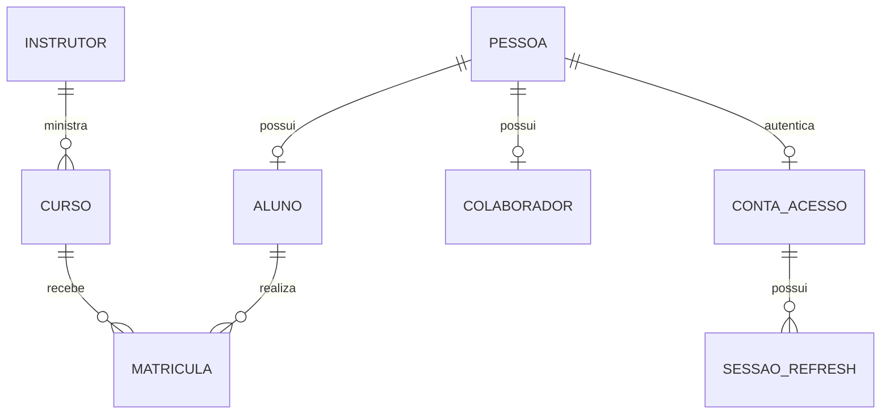
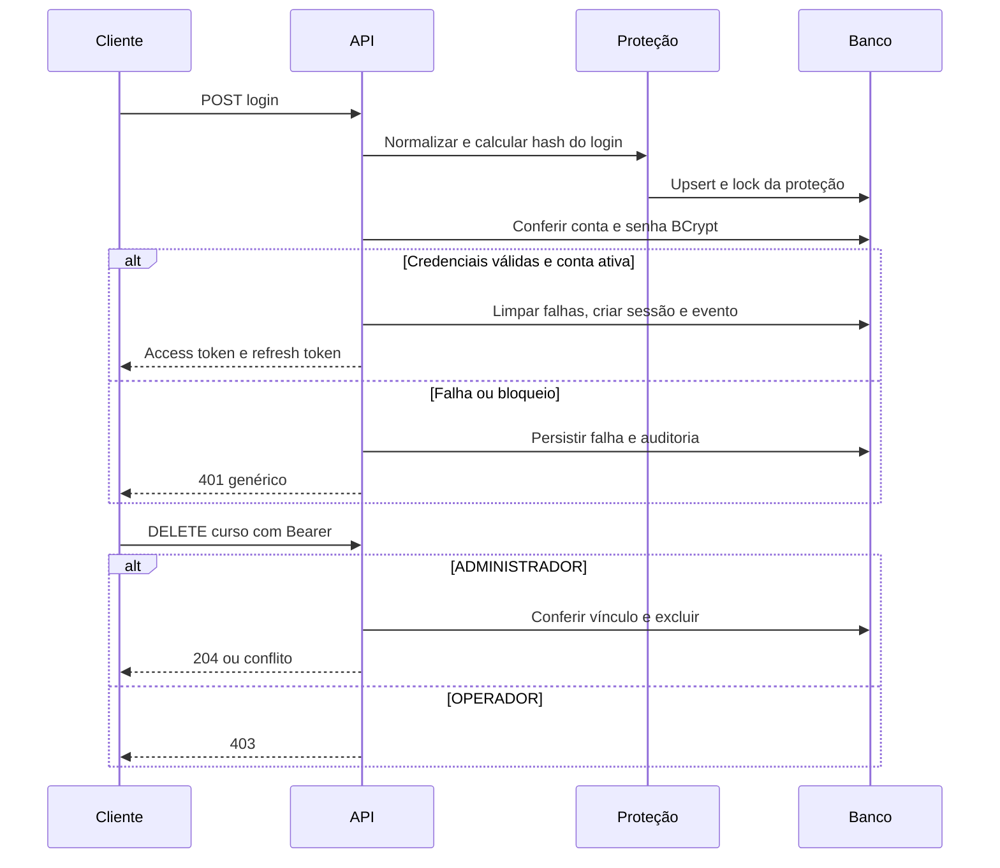

# Domínio, transações e segurança

## Correspondência com as aulas

| Aulas | Aplicação ao catálogo |
| --- | --- |
| 00–02 | Repositório independente, Java 21, Maven Wrapper, convenções e health |
| 03 | Instrutor e curso, enum de nível, coleção protegida e operações de domínio |
| 04–06 | PostgreSQL, perfis, Liquibase, constraints e evolução compatível de registros existentes |
| 07 | DTOs, mappers, validação, tratamento de erros e Location |
| 08 | CRUD, filtros, paginação, ativação e movimentação de vagas |
| 09 | OpenAPI, Swagger UI, exemplos e teste do contrato |
| 10 | Pessoa, aluno e colaborador por composição; matrícula N:M com preço histórico |
| 11 | Lock pessimista sobre o curso para coordenar a última vaga |
| 12–14 | Conta separada da pessoa, BCrypt, JWT, perfis e administrador inicial |
| 15 | Testes de domínio, serviço, PostgreSQL, HTTP, autorização e JaCoCo |
| 16 | Refresh opaco, hash, rotação, inatividade e revogação |
| 17 | Bloqueio configurável, auditoria e consulta administrativa |

A referência foi consultada no repositório [suporteos2026](https://github.com/jeffersonarpasserini/suporteos2026/tree/5625f85ef3108ef18277d08ad81ad1106352f363/docs), no estado disponível em 26/11/2026. Os números de testes e changeSets do sistema de vendas são próprios daquele domínio. No catálogo, os testes verificam os comportamentos correspondentes.

## Modelo

Pessoa contém a identidade usada pelos papéis acadêmicos e pela conta. Aluno e colaborador são papéis independentes. Uma pessoa pode ter ambos sem duplicar nome e email. A composição permite acrescentar um papel sem trocar o tipo da pessoa. Uma hierarquia de herança tornaria difícil representar a mesma pessoa simultaneamente como aluno e colaborador.

Instrutor preserva a entidade do catálogo original e sua relação 1:N com curso. Curso possui a chave estrangeira `instrutor_id`. O método `adicionarCurso` controla os dois lados e a API expõe DTOs.

Matrícula é a entidade associativa entre aluno e curso. Guarda valor, instante de criação e status. O preço é copiado no momento da confirmação e permanece histórico quando o preço do curso muda. Email identifica o contato da pessoa. CPF foi dispensado porque o catálogo acadêmico não emite documentos fiscais e não precisa desse dado pessoal para demonstrar os papéis.

O ID, o código, a data de criação e o instrutor responsável permanecem fixos após o cadastro do curso. O PUT altera título, carga horária, nível, preço e status. Movimentações de vagas usam POST porque representam uma operação acumulativa. DELETE retorna 204 quando conclui a exclusão, 404 para ID ausente e 409 quando há vínculos que impedem a operação. Dados fora do contrato retornam 400. Inativar o curso mantém o histórico e impede novas matrículas.

## Integridade e evolução

As chaves estrangeiras impedem referências órfãs. Os NOT NULL representam vínculos e campos obrigatórios. As restrições únicas protegem email, código do curso, login, papel por pessoa, matrícula por aluno/curso e hash do token. Os CHECKs impedem vagas e preço negativos. IDs usam identity do PostgreSQL.

A migração 005 usa a sequência expandir, preencher, restringir. Primeiro acrescenta código opcional, preenche os registros antigos com `CURSO-{id}` e depois aplica NOT NULL e UNIQUE. Os demais campos recebem padrões compatíveis. O arquivo 001 original foi preservado para manter os checksums já aplicados.

Os rollbacks removem primeiro dependências e depois tabelas. Reverter uma evolução que contém dados novos exige backup e decisão de retenção, pois o rollback estrutural elimina os campos adicionados.

## Transações e concorrência

A matrícula coordena dois efeitos na mesma transação. Reserva uma vaga e insere a matrícula. Se a inserção falha, a reserva é revertida. O cancelamento atualiza o status e devolve a vaga na mesma transação.

Sem lock, duas transações poderiam ler uma vaga e confirmar duas matrículas. O repository usa `PESSIMISTIC_WRITE` na linha do curso. A segunda transação aguarda a primeira e lê o saldo atualizado. O teste concorrente dispara dois alunos e comprova uma matrícula e zero vagas.

Foi escolhido lock pessimista porque uma vaga disputada tem alto custo de venda excedente e a transação é curta. Cada matrícula bloqueia um único curso, evitando ciclos entre cursos. Cancelamentos também bloqueiam primeiro o curso e depois a matrícula. A entidade é atualizada após o lock para evitar leitura antiga no contexto JPA. O teste de cancelamento concorrente confirma uma única devolução.

A política de autenticação usa upsert e `FOR UPDATE` por hash do login. Sessões são alteradas depois de bloquear a conta e depois o token. A ordem conta → sessão coordena refresh, logout e alterações administrativas. A proteção do último administrador usa um advisory lock transacional para serializar mudanças no conjunto de administradores ativos.

## Matriz de acesso

| Operação | Público | Operador | Administrador |
| --- | --- | --- | --- |
| Health, Swagger e OpenAPI em desenvolvimento | Sim | Sim | Sim |
| Login, refresh e logout por refresh token | Sim | Sim | Sim |
| Catálogo, pessoas, papéis e matrículas | — | Sim | Sim |
| Consultar conta e alterar a própria senha | — | Sim | Sim |
| Encerrar todas as próprias sessões | — | Sim | Sim |
| Criar contas, trocar perfis e status | — | — | Sim |
| Excluir cursos e instrutores | — | — | Sim |
| Consultar auditoria | — | — | Sim |

## Justificativa da autorização

A plataforma distingue a identidade de uma pessoa, seus papéis acadêmicos e as permissões de uso da API. Uma pessoa pode estudar e trabalhar na instituição, enquanto a conta de acesso representa suas credenciais. Essa separação evita colocar senha no cadastro de aluno ou condicionar o acesso a uma posição acadêmica. Os perfis OPERADOR e ADMINISTRADOR definem responsabilidades operacionais e são armazenados separadamente dos papéis de negócio.

O operador executa as atividades do catálogo e da secretaria. Ele pode consultar e cadastrar instrutores, cursos, pessoas e matrículas, além de alterar registros e movimentar vagas. O administrador também pode executar essas operações e fica responsável por criar contas e administrar seus perfis e status. Exclusões são administrativas porque podem afetar referências e remover registros usados pela equipe. O banco e os serviços ainda verificam vínculos para rejeitar exclusões incompatíveis com o histórico.

O JWT é emitido após a conferência da senha pelo PasswordEncoder. A senha persistida usa BCrypt e o token inclui emissor, identidade, emissão, expiração, perfis e identificação da família de sessão. O servidor obtém os perfis da conta persistida. O login não recebe uma escolha de privilégios do cliente. A configuração converte o claim de perfis em authorities com o prefixo ROLE_, consumidas pelas regras HTTP.

As operações de gestão de contas e consulta de auditoria são protegidas na cadeia HTTP e também nos serviços com autorização por método. Assim, uma chamada que passe por outro ponto da aplicação continua sujeita à política. Os testes diferenciam requisição sem credencial, que recebe 401, de uma conta válida sem a permissão necessária, que recebe 403.

A primeira identidade administrativa exige habilitação explícita e credenciais locais. O provisionamento é desativado por padrão e recusa bases que já tenham contas. A política também impede remover ou inativar o último administrador ativo, inclusive quando há alterações concorrentes. Toda mudança administrativa registra um evento na mesma transação.

O access token já emitido permanece válido até expirar. Alterações de senha, perfis e status revogam as sessões de renovação, enquanto a autorização de um JWT existente continua refletindo seus claims até a expiração. Essa limitação é documentada conforme as aulas e deve ser considerada na escolha do prazo do token.

## Login e autorização

## Decisão sobre tokens

O cliente HTTP guarda access e refresh tokens em variáveis locais de sessão. A coleção exportada contém apenas placeholders e nunca deve incluir o ambiente preenchido. Em um futuro frontend, a decisão de armazenamento deve considerar cookies HttpOnly, CSRF e XSS. Essa interface ainda não faz parte da API.

O access token dura 30 minutos. O refresh expira por 30 minutos sem renovação e tem limite absoluto de sete dias, sem prorrogação pela rotação. Esses prazos mantêm o ciclo de estudo observável e limitam o tempo de uso de uma credencial capturada. As propriedades são configuráveis.

Refresh tokens têm 32 bytes aleatórios e codificação Base64 URL-safe. O banco guarda somente SHA-256. Cada uso marca o token como consumido e cria outro na mesma família. A reutilização de um token revoga toda a família. Duas renovações simultâneas são serializadas pelo lock da conta. A primeira pode emitir um token e a segunda detecta replay, revogando a família. O teste concorrente confirma esse resultado.

O logout local revoga a família indicada pelo refresh. O logout global revoga as famílias da conta autenticada. O access token permanece válido até seu `exp`, conforme a limitação de JWT stateless da Aula 16. Senha alterada, conta bloqueada e perfis alterados impedem novas renovações com as sessões anteriores.

## Proteção e auditoria

A política inicial bloqueia o login após cinco falhas em quinze minutos, durante quinze minutos. Em um ambiente acadêmico pequeno, isso limita tentativas repetidas sem exigir intervenção para recuperar uma conta. Os valores podem ser ajustados por configuração e são validados no boot.

Os instantes são persistidos com precisão de microssegundos para alinhar Java ao PostgreSQL. O bloqueio termina exatamente no instante indicado. Sucesso limpa o contador e uma janela encerrada reinicia a contagem. Uma conta inexistente recebe a mesma resposta de uma senha incorreta.

Eventos contêm tipo, instante, ID da conta alvo, ID da conta responsável pela ação, hash do identificador e origem limitada. Senhas e tokens ficam fora dos eventos. A origem é obtida da conexão e os caracteres de controle são removidos. A consulta permite filtro por tipo e paginação, exige ADMINISTRADOR no HTTP e no serviço.

| Ameaça | Controle | Evidência | Risco residual |
| --- | --- | --- | --- |
| Tentativas repetidas de senha | Contador persistente e bloqueio | Quinta falha e liberação exata | Ataques distribuídos e password spraying |
| Enumeração por mensagem | Resposta 401 genérica e BCrypt fictício | Conta ausente e senha incorreta | Diferenças de tempo e volume |
| Roubo de refresh | Hash, uso único e revogação de família | Replay e renovação concorrente | Token roubado antes do primeiro uso |
| Escalada de perfil | Regras HTTP e método | Operador recebe 403 | JWT emitido mantém claims até expirar |
| Excesso de matrículas | Lock e transação | Dois alunos para uma vaga | Espera de lock sob carga |
| Perda de evidência | Evento na transação da mudança | Alterações e eventos consultados | Retenção e gestão de acesso operacional |

Em produção, ainda devem ser definidas retenção da auditoria, limites de tráfego e observabilidade operacional. O perfil prod desabilita a documentação pública. A geração automática de OpenAPI complementa os testes, pois uma descrição pode divergir do comportamento se não for revisada.
